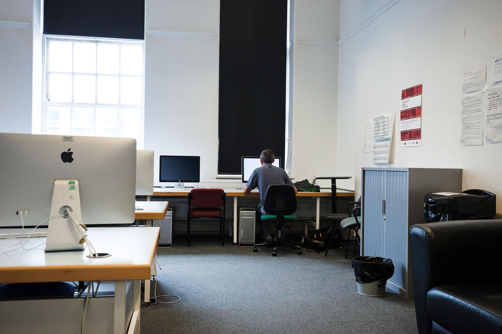
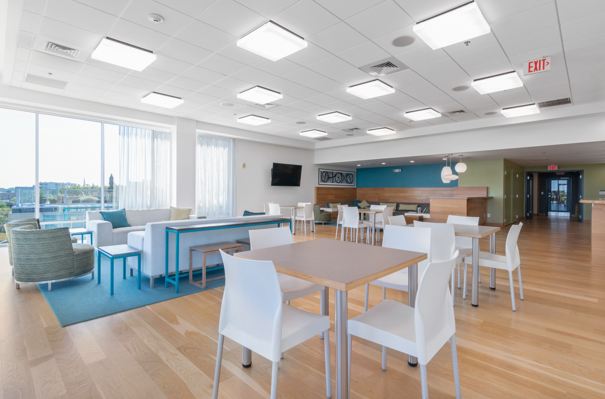

<div align="center">


<br>

### Conectando estudantes, espaços e oportunidades dentro do campus.


<br><br>


<br><br>


<br><br>

<a href="#sobre-o-projeto">Sobre</a> •
<a href="#objetivos">Objetivos</a> •
<a href="#páginas-do-projeto">Páginas</a> •
<a href="#tecnologias">Tecnologias</a> •
<a href="#estrutura-do-projeto">Estrutura</a> •
<a href="#equipe">Equipe</a>

</div>

---

# Sobre o projeto

O **Conecta Campus** é um projeto acadêmico desenvolvido pela equipe **Dandelion**, durante o **Checkpoint 2 da disciplina de Front-End Design Engineering**, do curso de Análise e Desenvolvimento de Sistemas da FIAP.

A proposta é construir um ambiente digital que reúna informações sobre os espaços, serviços e atividades disponíveis em um campus, permitindo que os estudantes conheçam melhor sua estrutura e aproveitem as oportunidades oferecidas pela instituição.

Mais do que apresentar os ambientes, o projeto busca proporcionar uma experiência de navegação clara e organizada, facilitando a consulta de informações como localização, categoria, serviços oferecidos, orientações de utilização e acessibilidade.

Nesta etapa, o desenvolvimento foi concentrado nos fundamentos de **HTML5, CSS3, Git e GitHub**, com atenção à organização do código, estrutura semântica, identidade visual, acessibilidade e colaboração em equipe.

> O Conecta Campus foi desenvolvido como um site estático, utilizando os conceitos estudados durante as aulas, sem necessidade de JavaScript, frameworks ou integração com banco de dados.

---

# Objetivos

O objetivo principal do projeto é facilitar o acesso às informações sobre a infraestrutura acadêmica por meio de uma interface intuitiva.

### O que buscamos oferecer

- **Centralização de informações:** reunir os principais ambientes do campus em um único local.
- **Facilidade de navegação:** permitir que os usuários encontrem rapidamente os espaços e serviços disponíveis.
- **Informações detalhadas:** apresentar localização, categoria, recursos e orientações de utilização.
- **Acessibilidade:** considerar a organização semântica, os textos alternativos e a identificação dos elementos interativos.
- **Experiência acadêmica:** incentivar os estudantes a conhecerem e aproveitarem os recursos oferecidos.
- **Organização visual:** desenvolver uma interface consistente entre as páginas.

<div align="center">

### Conheça. Explore. Conecte-se.

**O campus oferece oportunidades que vão além da sala de aula.**

</div>

---

# Identidade visual

A identidade visual do Conecta Campus foi desenvolvida para transmitir uma experiência acolhedora, organizada e relacionada ao ambiente acadêmico.

A interface utiliza uma combinação de tons de vinho, verde-escuro e bege, criando contraste entre os elementos e mantendo uma apresentação visual consistente.

### Paleta de cores

<div align="center">


</div>

### Tipografia

O projeto utiliza duas famílias tipográficas principais:

| Fonte | Aplicação |
|---|---|
| **Georgia** | Títulos, textos e conteúdos informativos |
| **Arial** | Navegação, identidade visual e elementos de interface |

As fontes, cores e tamanhos são organizados por meio de variáveis CSS, facilitando a padronização entre as páginas.

---

# Páginas do projeto

O Conecta Campus é composto por quatro páginas HTML conectadas entre si.

## 01. Página Inicial — Home

**Arquivo:** `index.html`

A página inicial apresenta o Conecta Campus, contextualiza sua finalidade e permite que o usuário conheça os principais espaços e serviços disponíveis.

**Principais elementos:**

- Apresentação e identidade visual do projeto.
- Navegação entre as páginas.
- Destaque de espaços do campus.
- Informações sobre benefícios e recursos.
- Links para explorar outras áreas do site.

[Acessar código da Home](./index.html)

---

## 02. Locais e Serviços

**Arquivo:** `locais.html`

A página Locais reúne informações sobre os principais ambientes do campus.

Cada espaço possui uma apresentação própria, acompanhada por uma imagem e informações relevantes para a rotina acadêmica.

**Informações apresentadas:**

- Nome do espaço.
- Categoria.
- Localização.
- Orientações e informações úteis.
- Imagem ilustrativa.
- Link para a seção correspondente em Detalhes.

[Acessar código de Locais](./locais.html)

---

## 03. Detalhes dos Espaços

**Arquivo:** `detalhes.html`

A página Detalhes aprofunda as informações dos ambientes apresentados anteriormente.

Além das informações gerais, são apresentadas orientações de utilização, serviços oferecidos e informações de acessibilidade.

Também foi incluída uma seção dedicada às atividades do campus, apresentando oportunidades relacionadas à tecnologia, cultura, esportes, comunidade, literatura e jogos.

**Principais recursos:**

- Informações detalhadas sobre cada ambiente.
- Serviços e orientações.
- Informações de acessibilidade.
- Navegação por identificadores de seção.
- Apresentação de atividades acadêmicas e extracurriculares.

[Acessar código de Detalhes](./detalhes.html)

---

## 04. Integrantes

**Arquivo:** `integrantes.html`

A página Integrantes apresenta as responsáveis pelo desenvolvimento do Conecta Campus.

Cada integrante é identificada por nome, RM, turma, foto e links para seus perfis profissionais.

**Informações apresentadas:**

- Nome completo.
- Registro de matrícula (RM).
- Turma.
- Fotografia.
- GitHub.
- LinkedIn.

[Acessar código de Integrantes](./integrantes.html)

---

# Espaços do campus

<div align="center">

<table>
<tr>
<td align="center" width="33%">

<br><br>
<strong>Biblioteca Central</strong>
<br>
<sub>Estudo, pesquisa e conhecimento.</sub>
<br><br>
<a href="./detalhes.html#biblioteca">Ver detalhes</a>
</td>

<td align="center" width="33%">

<br><br>
<strong>Laboratório de Informática</strong>
<br>
<sub>Tecnologia e aprendizado prático.</sub>
<br><br>
<a href="./detalhes.html#laboratorio">Ver detalhes</a>
</td>

<td align="center" width="33%">

<br><br>
<strong>Sala de Convivência</strong>
<br>
<sub>Descanso, integração e socialização.</sub>
<br><br>
<a href="./detalhes.html#sala-convivencia">Ver detalhes</a>
</td>
</tr>
</table>

</div>

## Biblioteca Central

Ambiente destinado ao estudo, à leitura, à pesquisa e ao desenvolvimento acadêmico.

O espaço apresenta informações sobre localização, horário de funcionamento, serviços oferecidos, orientações e recursos de acessibilidade.

## Laboratório de Informática

Espaço dedicado às aulas práticas e às atividades relacionadas à tecnologia.

O laboratório disponibiliza computadores para apoiar o aprendizado e o desenvolvimento de atividades acadêmicas, conforme a programação e a disponibilidade do ambiente.

## Sala de Convivência

Ambiente voltado ao descanso, à integração e à socialização entre estudantes.

O espaço foi pensado para proporcionar momentos de interação e convivência durante os intervalos das atividades acadêmicas.

---

# Atividades do campus

Além dos espaços físicos, o projeto apresenta atividades que podem contribuir para o desenvolvimento dos estudantes fora da sala de aula.

| Categoria | Atividade |
|---|---|
| Tecnologia | Clube de Programação |
| Cultura | Oficina de Arte e Expressão |
| Esportes | Clube de Esportes |
| Comunidade | Projetos de Voluntariado |
| Literatura | Clube do Livro |
| Jogos | Clube de Jogos e Estratégia |

Também é apresentado o destaque **Arena Gamer**, voltado à interação, estratégia e entretenimento.

> As atividades fazem parte do conteúdo demonstrativo do projeto acadêmico e não representam necessariamente uma programação oficial de uma instituição.

---

# Tecnologias

<div align="center">

### Desenvolvimento Web


<br><br>

### Versionamento e colaboração


<br><br>

### Ambiente de desenvolvimento


</div>

<br>

| Tecnologia | Utilização |
|---|---|
| **HTML5** | Estruturação semântica das páginas |
| **CSS3** | Estilização e organização visual |
| **Git** | Controle de versões e registro das alterações |
| **GitHub** | Hospedagem do repositório e colaboração |
| **VS Code** | Desenvolvimento e edição dos arquivos |

---

# Conceitos aplicados

O desenvolvimento do Conecta Campus permitiu aplicar conceitos fundamentais de desenvolvimento Front-End.

### HTML5

- Estrutura básica de documentos HTML.
- Elementos semânticos: `header`, `nav`, `main`, `section`, `article` e `footer`.
- Hierarquia de títulos.
- Listas, links e imagens.
- Identificação de seções por IDs.
- Textos alternativos em imagens.
- Caminhos relativos para arquivos.

### CSS3

- Reset CSS.
- `box-sizing: border-box`.
- Seletores de elementos, classes e IDs.
- Variáveis CSS com `:root`.
- Tipografia e hierarquia visual.
- Paleta de cores.
- Box Model: `margin`, `padding` e `border`.
- Organização de layouts com Flexbox e Grid.
- Pseudo-classes como `:hover` e `:focus-visible`.

### Git e GitHub

- Criação e utilização de branches.
- Commits para registrar alterações.
- Integração de mudanças com a branch principal.
- Resolução de conflitos.
- Pull Requests.
- Colaboração e histórico de desenvolvimento.

---

# Acessibilidade

A acessibilidade foi considerada na organização estrutural do projeto.

Entre os cuidados aplicados e previstos estão:

- Utilização de `lang="pt-BR"`.
- Uso de elementos HTML semânticos.
- Textos alternativos para imagens.
- Links com descrições compreensíveis.
- Identificação das áreas de navegação.
- Indicação visual de foco para navegação por teclado.
- Organização da hierarquia de títulos.
- Contraste entre texto e fundo.

A proposta é permitir que as informações sejam apresentadas de forma clara e possam ser consultadas por diferentes usuários.

---

# Estrutura do projeto

```text
front-end-cp2/
│
├── css/
│   └── style.css
│
├── img/
│   ├── atividades.jpg
│   ├── biblioteca.jpg
│   ├── campos_backgroud.jpg
│   ├── campus_aberto.jpg
│   ├── equipe.jpg
│   ├── eventos.jpg
│   ├── jogos.jpg
│   ├── laboratório_de_informática.jpg
│   ├── sala_de_convivencia.jpg
│   ├── img-01_mirella.jpeg
│   ├── img-02_malu.png
│   ├── img-03_gaby.png
│   ├── img-04_rayza.png
│   └── img-05_sofia.jpeg
│
├── index.html
├── locais.html
├── detalhes.html
├── integrantes.html
└── README.md
```

### Organização dos arquivos

| Arquivo ou pasta | Finalidade |
|---|---|
| `index.html` | Página principal |
| `locais.html` | Listagem dos espaços do campus |
| `detalhes.html` | Informações detalhadas e atividades |
| `integrantes.html` | Apresentação da equipe |
| `css/style.css` | Estilização compartilhada |
| `img/` | Imagens e recursos visuais |
| `README.md` | Documentação do projeto |

---

# Como executar o projeto

O Conecta Campus é um projeto estático e não exige instalação de dependências.

### 1. Clone o repositório

```bash
git clone https://github.com/TDB-challenge/front-end-cp2.git
```

### 2. Acesse a pasta

```bash
cd front-end-cp2
```

### 3. Abra no VS Code

```bash
code .
```

### 4. Execute o projeto

Abra o arquivo `index.html` diretamente em seu navegador.

Também é possível utilizar a extensão **Live Server** do Visual Studio Code.

```text
index.html
    ↓
Open with Live Server
    ↓
Navegador
```

---

# Desenvolvimento colaborativo

O projeto foi desenvolvido em grupo, utilizando Git e GitHub para organizar as contribuições das integrantes.

A utilização de branches permitiu trabalhar em diferentes partes do projeto, registrar alterações e integrar as funcionalidades de forma colaborativa.

### Fluxo de trabalho

```text
Branch principal (main)
        ↓
Criação de branch
        ↓
Desenvolvimento
        ↓
Commits
        ↓
Push para o GitHub
        ↓
Pull Request
        ↓
Revisão e integração
        ↓
Branch main atualizada
```

Esse processo contribuiu para a organização do código, o acompanhamento das alterações e a experiência prática com desenvolvimento colaborativo.

---

# Equipe

<div align="center">

## Dandelion | 1TDSPB

### As desenvolvedoras por trás do Conecta Campus

<br>

<table>
<tr>
<td align="center" width="20%">

<br><br>
<strong>Gabrielly Macario de Souza Ribeiro</strong>
<br>
<sub>RM575133 • 1TDSPB</sub>
<br><br>
<a href="https://github.com/GMacarioxz">

</a>
<br>
<a href="https://www.linkedin.com/in/gabriellymcr-ribeiro/">

</a>
</td>

<td align="center" width="20%">

<br><br>
<strong>Maria Luiza de Castro Antunes</strong>
<br>
<sub>RM575122 • 1TDSPB</sub>
<br><br>
<a href="https://github.com/MLui-za">

</a>
<br>
<a href="https://www.linkedin.com/in/maria-luiza-de-castro-antunes-3a026a441">

</a>
</td>

<td align="center" width="20%">

<br><br>
<strong>Rayza Salles Almeida do Nascimento</strong>
<br>
<sub>RM576940 • 1TDSPB</sub>
<br><br>
<a href="https://github.com/ray-web03">

</a>
<br>
<a href="https://www.linkedin.com/in/rayza-s-72a00a211">

</a>
</td>
</tr>
<tr>
<td align="center" width="20%">

<br><br>
<strong>Sofia Balieiro Yamane Caro</strong>
<br>
<sub>RM574510 • 1TDSPB</sub>
<br><br>
<a href="https://github.com/sofia-yamane">

</a>
<br>
<a href="https://www.linkedin.com/in/sofia-yamane-024a043b3">

</a>
</td>

<td align="center" width="20%">

<br><br>
<strong>Taiane Mirella Santos de Alcântara</strong>
<br>
<sub>RM575845 • 1TDSPB</sub>
<br><br>
<a href="https://github.com/mirella-alcantara">

</a>
<br>
<a href="https://www.linkedin.com/in/taiane-mirella/">

</a>
</td>
</tr>
</table>

</div>

---

# Informações acadêmicas

| Informação | Descrição |
|---|---|
| **Instituição** | FIAP |
| **Curso** | Análise e Desenvolvimento de Sistemas |
| **Disciplina** | Front-End Design Engineering |
| **Professor** | Alexandre Carlos de Jesus |
| **Projeto** | Conecta Campus |
| **Equipe** | Dandelion |
| **Avaliação** | Checkpoint 2 |
| **Turma** | 1TDSPB |
| **Ano** | 2026 |
| **Tecnologias** | HTML5, CSS3, Git e GitHub |

---

# Aprendizados

O desenvolvimento do Conecta Campus proporcionou uma oportunidade de aplicar os conhecimentos estudados em sala de aula em um projeto colaborativo.

Entre os principais aprendizados estão a construção de páginas semânticas, a organização de um arquivo CSS compartilhado, a importância da padronização visual e a utilização do Git e GitHub no desenvolvimento em equipe.

Também foi possível compreender melhor como decisões relacionadas à navegação, à estrutura dos elementos, à tipografia e à acessibilidade influenciam a experiência do usuário.

Além da parte técnica, o projeto contribuiu para o desenvolvimento da comunicação, da colaboração e da resolução de problemas em grupo.

---

# Links úteis

<div align="center">

<a href="https://www.fiap.com.br/">

</a>

<a href="https://github.com/TDB-challenge/front-end-cp2">

</a>

</div>

---

<div align="center">

<br>

## CONECTA campus

### Explore espaços, descubra recursos e viva experiências além da sala de aula.

**Equipe Dandelion • FIAP • Checkpoint 2 • 2026**

<br>

`HTML5` • `CSS3` • `Git` • `GitHub` • `Acessibilidade` • `Colaboração`

<br><br>


</div>
